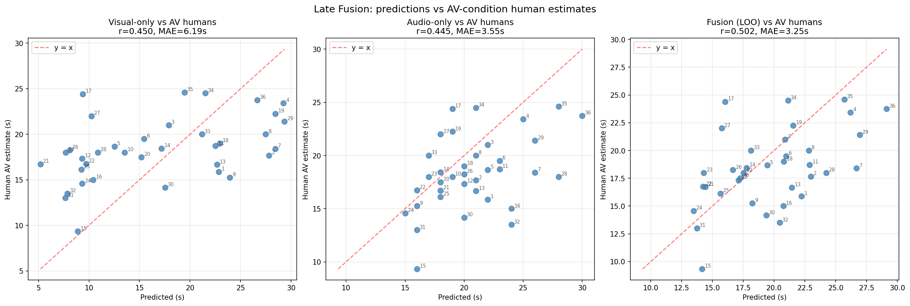
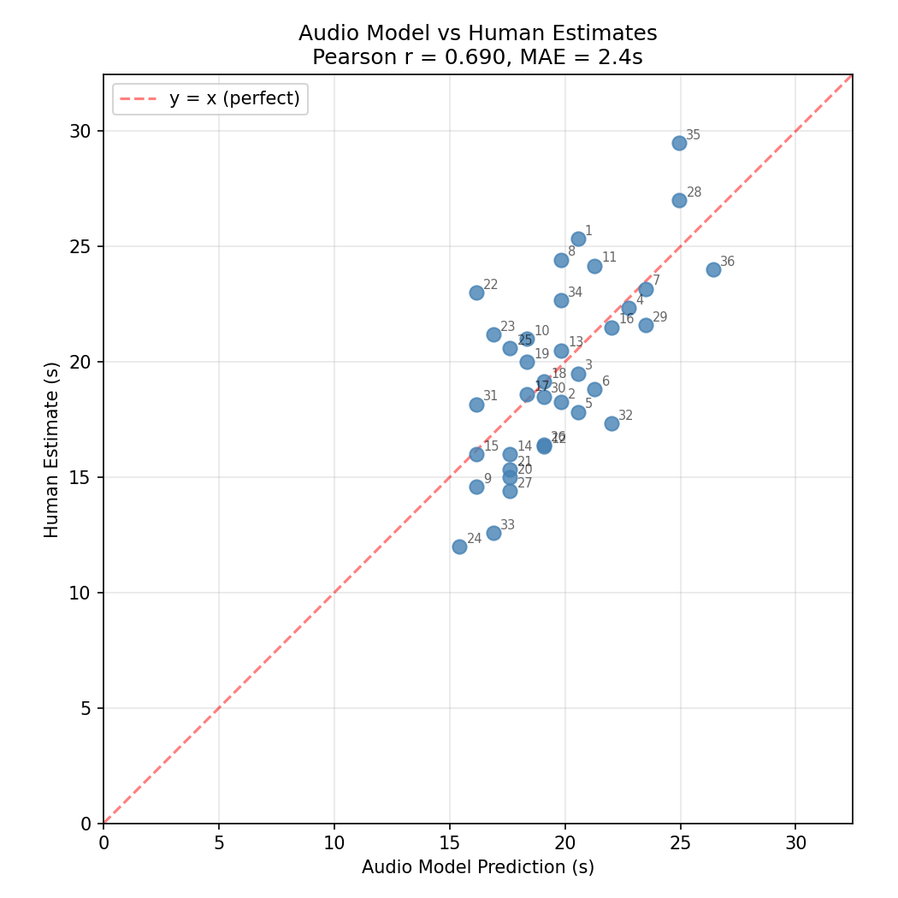
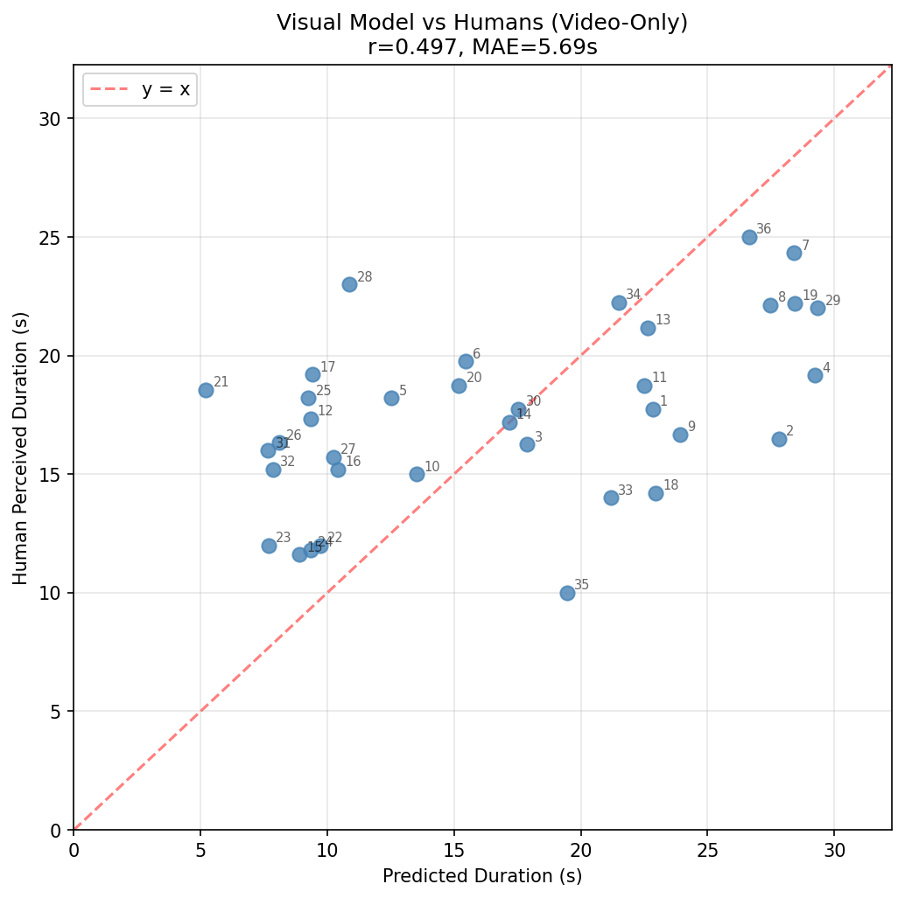

# Perceived Time from Audio-Visual Change

**Can a neural network tell how long a video *felt*?** This project models human subjective duration (how long a 20–25 s clip *seems* to last) by counting salient changes in deep-network representations of what you see and hear, then compares the model against judgments collected from real participants.

It extends the visual accumulator model of [Roseboom et al. (2019, *Nature Communications*)](https://doi.org/10.1038/s41467-018-08194-7) with an **audio pathway (OpenL3)** and a **late-fusion model**, and validates all three against a purpose-built online experiment.



## Highlights

- **End-to-end research pipeline**: video preprocessing → deep feature extraction → accumulator model → calibration → human-data evaluation.
- **Replicated a published model**: re-implemented the Roseboom et al. visual accumulator on AlexNet (conv2, pool5, fc7, output layers), calibrated with an RBF-kernel SVR on 4,251 human trials from the original study's 33 videos.
- **Extended it to audio**: the same tick-counting accumulator driven by OpenL3 audio embeddings.
- **Ran my own human experiment**: a jsPsych web experiment (separate repo) collected **525 duration judgments from 35 participants** on 36 first-person travel clips, each viewed in one of three conditions: video-only (V), audio-only (A) or audio-visual (AV).
- **Multisensory fusion**: a linear late-fusion model, evaluated with leave-one-out cross-validation.

## Results

36 travel clips, model predictions vs per-clip mean human estimates (seconds):

| Model | Compared against | Pearson r | MAE (s) |
|---|---|---|---|
| Visual-only | Video-only humans | 0.50 | 5.69 |
| Audio-only | Audio-only humans | **0.69** | **2.79** |
| Visual-only | Audio-visual humans | 0.45 | 6.19 |
| Audio-only | Audio-visual humans | 0.44 | 3.55 |
| **Late fusion (LOO-CV)** | Audio-visual humans | **0.50** | **3.25** |

**Key finding:** the fusion model weights audio at **0.73** vs visual at **0.27**. In these naturalistic clips, auditory change explained more of the variation in perceived duration than visual change. Combining the two improved the audio-visual fit over either modality alone.

Full metrics: [`results/fusion/fusion_metrics.json`](results/fusion/fusion_metrics.json) · per-clip predictions: [`results/fusion/fusion_predictions.csv`](results/fusion/fusion_predictions.csv)

| Audio model vs humans | Visual model vs humans |
|---|---|
|  |  |

## How it works

```
             ┌─ frames (30 fps, 224 px) ─→ AlexNet layers ─→ L2 change per frame ─┐
video clip ──┤                                                                    ├─→ accumulator ─→ ticks ─→ calibration ─→ seconds
             └─ audio (48 kHz, RMS-norm) ─→ OpenL3 embeddings ─→ L2 change ───────┘        │
                                                                                            ▼
                                       late fusion:  pred_AV = w_v · visual + w_a · audio
```

**Accumulator:** a "tick" fires when the attention-weighted change between consecutive embeddings crosses an adaptive threshold. The visual threshold decays between ticks; the audio threshold tracks a running mean + k·σ. A refractory period stops ticks firing back to back. Tick counts are then mapped to seconds with a calibration fitted to human judgments (an SVR for visual, linear regression for audio).

## Repository layout

```
scripts/
  preprocess_data.py            normalise audio loudness, extract standardised frames
  visual_extract_alexnet.py     AlexNet features + per-frame change metrics
  audio_extract_features.py     audio embeddings + per-segment change metrics
  train_audio_calibration.py    fit ticks → seconds mapping for audio
  generate_labels.py            raw experiment exports → per-clip mean human labels
notebooks/
  visual_model.ipynb            1. Roseboom replication + SVR calibration (33 videos, 4,251 trials)
  visual_predict_travel2.ipynb  2. apply visual model to the 36 experiment clips
  audio_model.ipynb             3. OpenL3 audio accumulator + calibration
  late_fusion.ipynb             4. combine modalities, LOO-CV evaluation
models/                         final model parameters and calibration pickles
results/                        figures and summary metrics
```

## Running it

Requires Python 3.8–3.10 and FFmpeg. A CUDA GPU is optional but speeds up feature extraction.

```bash
python -m venv .venv
.venv\Scripts\activate          # macOS/Linux: source .venv/bin/activate
pip install -r requirements.txt
python main.py                  # dependency + CUDA check

python scripts/preprocess_data.py --input-dir <your_clips> --save-frames --frames-fps 30 --frame-size 224
```

Then run the notebooks in the order listed above. The video clips and participant-level responses are **not included**: the clips are third-party footage, and the response data is covered by the study's ethics terms. See [`data/README.md`](data/README.md) for the expected layout.

## Tech stack

Python · PyTorch / torchvision (AlexNet) · OpenL3 / TensorFlow · librosa · OpenCV · MoviePy · scikit-learn · pandas · matplotlib · Jupyter · jsPsych (experiment front end)

## Context

Individual capstone project. The participant-facing experiment website is maintained in a separate repository.
